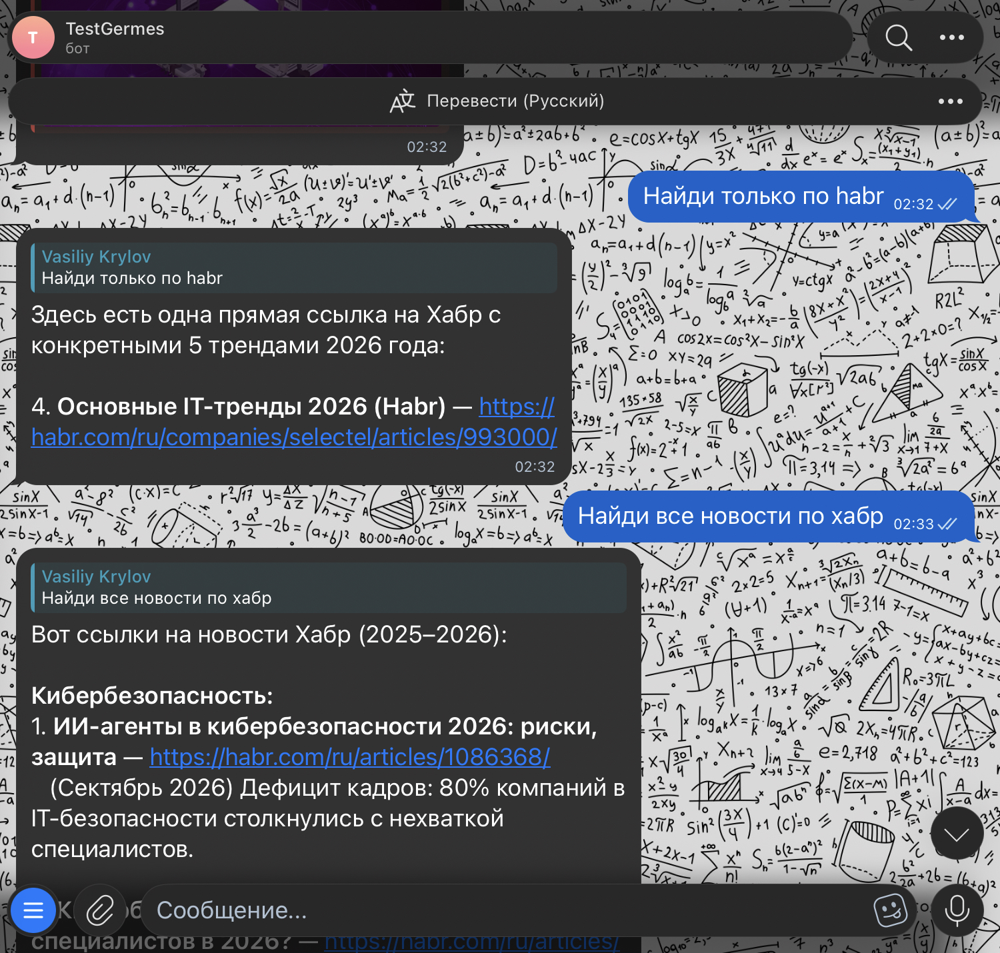
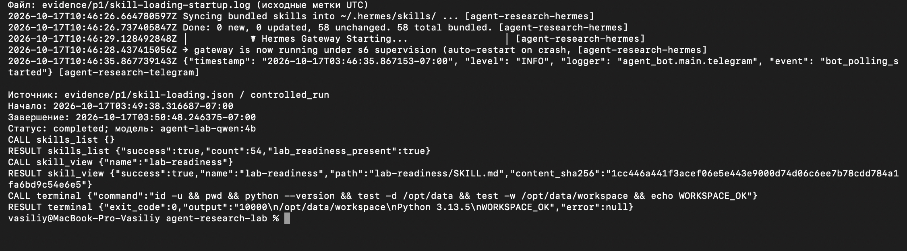
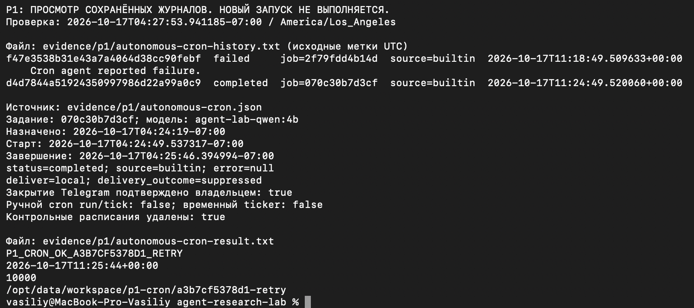

# P1 Развёртывание и автономность агента

**Статус: результаты выполненных проверок оформлены; P1 закрыт не полностью.**
Подтверждены диалог через Telegram, загрузка диагностического навыка,
восстановление после перезагрузки Linux VM и автономный cron с локальным
результатом. Реальная проверка отказа второму аккаунту остаётся открытой.
Снимки Terminal со стартом и cron, а также отдельного диалога с ботом
в Telegram добавлены. Перед сдачей также требуется согласование пункта
о панели расходов при использовании локальной модели.

[Репозиторий работы](https://github.com/WhoamiTitle/agent-research-lab).
Основание — [исходное задание](../sources/assignment-02.txt) и его
[раздел подготовки](../sources/assignment-02-preparation.txt).
Работа выполняется вдвоём с общим отчётом; за P2 отвечает второй участник.
В этом разделе рассматриваются развёртывание и технические проверки P1.

Результаты относятся к сохранённым проверкам 15–17 октября 2026 года.
Дата оформления раздела не означает нового запуска экспериментов.
Время в таблицах — `America/Los_Angeles`, для этих дат PDT (UTC−07:00).
Исходные UTC-поля и временные метки журналов сохранены в приложениях.
Ранние записи подготовки датируются по их первичным материалам.

## Итоговая конфигурация

Основной режим проверки автономности: Telegram → собственный бот
aiogram/Dishka в VM → Hermes API в VM → Ollama на Mac через обратный
SSH-туннель. Дополнительный режим переносит Ollama в Docker внутри VM.

| Компонент | Конфигурация, принятая к завершению проверок |
| --- | --- |
| Хост | Mac, Apple M4, macOS ARM64, 16 GiB RAM, 10 логических CPU |
| VM `agent-research` | Lima 2.2.1, Ubuntu 24.04 ARM64, 2 vCPU, **10 GiB RAM**, диск 24 GiB; общих каталогов Mac нет |
| Docker | Engine 29.9.1, Compose 5.6.0; Docker включён в автозапуск systemd |
| Hermes | `v0.21.6`, образ закреплён digest в Compose; контейнер `agent-research-hermes` |
| Собственный бот | `src/agent_bot`, aiogram/Dishka, контейнер `agent-research-telegram`; встроенный Telegram Hermes отключён |
| Модель | Ollama 0.35.1, `agent-lab-qwen:4b` на основе `qwen3.5:4b`, Q4_K_M |
| Профиль модели | Контекст 65 536, предел ответа 2048 токенов, `temperature=0.2`; в Hermes `reasoning_effort: none` |
| Маршрут модели | `provider: custom`, `http://127.0.0.1:11434/v1`; облачный fallback отсутствует |
| API Hermes | `127.0.0.1:8642` внутри VM, отдельный секретный ключ; неавторизованный запуск получил HTTP 401 |
| Ограничения работы | Один параллельный запуск API, до 8 ходов агента, `gateway_timeout=300` с, тайм-аут команды `terminal` — 60 с |
| Данные | `/srv/agent-lab/data` в VM → `/opt/data`; рабочий каталог `/opt/data/workspace` |
| Секреты бота | Только `/srv/agent-lab/bot/.env` в VM, UID/GID 10000, права `0600`; значения не входят в отчёт |
| Доступ | Один владелец, только личные сообщения; группы, посторонние и allow-all запрещены до вызова Hermes |
| Автовосстановление | `restart: unless-stopped` у сервисов; Ollama на Mac и SSH-туннель обслуживаются launchd в пользовательской сессии |

Конфигурации: [VM](../infra/lima/agent-lab.yaml),
[Compose с комментариями](../infra/hermes/compose.yaml),
[Hermes](../infra/hermes/config.yaml), [Modelfile](../infra/ollama/Modelfile).
Сведения о хосте и итоговой памяти VM — в
[окружении замеров](../evidence/ollama/environment.json), версии VM/Docker — в
[первоначальной проверке инфраструктуры](../evidence/p1/infrastructure.json).
Первоначальная запись содержит меньший объём памяти VM и сохранена как история;
её значение не используется как условие последующих итоговых замеров.
Digest профиля модели, совпавший в двух режимах:
`338d8b68d59f40bcfbbeffced53f2f4039bd180f5cd7cd79be5754359b215311`.

| Сервис или режим | Где исполняется | Лимиты ресурсов | Область проверки |
| --- | --- | --- | --- |
| Hermes | Docker в VM; рабочий процесс UID/GID 10000, s6-init — root | 2300 MiB RAM, 2 CPU, 512 процессов | Диалог, навык, ребут, cron |
| Собственный бот | Docker в VM, UID/GID 10000, корневая ФС только для чтения | 256 MiB RAM, 0,5 CPU, 64 процесса | Polling, доступ владельца, отправка ответов, ребут |
| Ollama `mac`, основной режим | Mac, Metal/GPU; VM обращается через SSH-туннель | Одна загруженная модель и один параллельный запрос; отдельного лимита RAM через cgroup нет | Все контрольные запуски P1 и отдельный прямой замер |
| Ollama `docker`, дополнительный режим | Docker в VM, CPU, UID/GID 10000 | 7 GiB RAM, 2 CPU, 128 процессов | Прямая генерация и проверки конфигурации; восстановление этого режима после ребута не проверялось |

Локальная VM выбрана по разделу «Ход работы», допускающему этот вариант.
Аренда VPS не производится. Домашний каталог Mac, SSH-агент и Docker-сокет
в Hermes не монтируются. Пользователь `researcher` не входит в группу Docker;
парольный SSH, вход root и перенаправление SSH-агента отключены, UFW активен.
Проверка рабочего пользователя и ограничений контейнера сохранена в
[container-runtime.json](../evidence/p1/container-runtime.json);
состояние доступа работающего бота — в
[outsider-preflight.json](../evidence/p1/outsider-preflight.json).

Для повторной настройки используется `./scripts/lab.sh setup --gateway-only`,
для запуска — `./scripts/lab.sh gateway`; порядок действий описан в
[инструкции управления](local-setup.md#настройка-hermes-и-telegram).
Выбор модели на Mac или в Docker: `LAB_OLLAMA_BACKEND=mac|docker`.
Код бота и границы его ответственности описаны в
[документации бота](telegram-bot.md).

## Требования P1 и подтверждения

| Требование | Результат | Материалы или оставшееся действие |
| --- | --- | --- |
| Конфигурация с комментариями | Выполнено | [compose.yaml](../infra/hermes/compose.yaml), итоговая конфигурация выше |
| Работоспособность Docker | Подтверждена | [hello-world.txt](../evidence/p1/hello-world.txt) |
| Старт, активный шлюз и загрузка навыка | Подтверждены, снимок добавлен | [Журнал старта](../evidence/p1/skill-loading-startup.log), [вызовы инструментов](../evidence/p1/skill-loading.json), [снимок Terminal](../evidence/p1/screenshots/hermes-startup-terminal.png) |
| Диалог через шлюз | Контрольные вопросы и ответы сохранены в журналах, отправка через Telegram API успешна; добавлен снимок отдельного диалога | [Протокол контрольного диалога](../evidence/p1/telegram-ollama-dialogue.json), [снимок Telegram](../evidence/p1/screenshots/telegram-dialogue.png); показанные на снимке сообщения не сопоставлены с контрольными запусками |
| Восстановление после перезагрузки сервера | Подтверждено для Linux VM при работающем Mac | [Протокол ребута](../evidence/p1/vm-reboot.json), [журнал восстановления](../evidence/p1/vm-reboot-startup.log) |
| Cron при закрытом клиенте | Подтверждено выполнение штатным планировщиком; закрытие клиента подтвердил пользователь; снимок добавлен | [Протокол](../evidence/p1/autonomous-cron.json), [файл результата](../evidence/p1/autonomous-cron-result.txt), [снимок Terminal](../evidence/p1/screenshots/hermes-cron-terminal.png) |
| Отказ постороннему аккаунту со снимком экрана | **Открыто: реальная попытка не выполнена** | [Подготовка и изолированные тесты](../evidence/p1/outsider-preflight.json) не заменяют этот пункт |
| Панель провайдера LLM с лимитом расходов | **Снимка нет: используется локальная Ollama** | Описаны расходы и ограничения; принятие этого варианта вместо панели требует согласования с преподавателем |
| Журнал не менее трёх реальных ошибок | Выполнено | Подраздел «Журнал отладки» с текстом, гипотезой, проверкой и результатом |

Добавлены два оригинальных снимка Terminal, предоставленных владельцем:
они показывают просмотр сохранённых материалов от 17 октября, без нового
выполнения проверок. Отдельный снимок Telegram показывает другой диалог
с ботом; дата и часовой пояс в кадре не установлены. Изображения не редактировались;
контрольные суммы
и сведения о сверке сохранены в [метаданных](../evidence/p1/screenshots/metadata.json).
[Памятка](../evidence/p1/screenshots/README.md) содержит описание снимков,
границы их подтверждений и команды повторного просмотра журналов.

## Замеры: условия и результаты

Таблицы составлены по сохранённым JSON и журналам, без новых прогонов.
Вызов инструмента означает одну запись `tool_call`, а не один ход LLM.
Если счётчик не сохранён в протоколе, указан прочерк; он не означает ноль.
Токены приведены по usage Hermes или cron usage audit. Они включают служебный
контекст и историю и могут суммироваться по нескольким обращениям к модели.
`Cache read` — часть входа по отчёту Hermes; повторно к входным токенам
она не прибавляется.

### Контрольные запуски Hermes и Telegram

Все строки относятся к локальной `agent-lab-qwen:4b`, `provider=custom`,
Ollama на Mac; параллельная нагрузка специально не создавалась.
В ранних протоколах G0/D1/D2 объём RAM VM в момент запроса не записан:
подставлять в них позднюю итоговую конфигурацию нельзя.

| ID, дата | Условия одного запуска | Граница измерения времени | Время, с | Результат | Вызовы инструментов |
| --- | --- | --- | --- | --- | --- |
| G0, 16.10 | Отдельная сессия API через `HermesGatewayImpl`, без Telegram | Полный вызов клиента; время фиксации результата 11:04:18 | 51,76 | Ожидаемое слово получено | — |
| D1, 16.10 | Telegram: «Ответь одним словом: готов», первый сохранённый запрос пары | `hermes_run_admitted` 13:00:10,853 → `reply_sent` 13:01:03,033 | 52,180 | `completed`, «Готов.» отправлено | — |
| D2, 16.10 | Повтор D1 с использованием кеша входа | 13:01:03,220 → 13:01:04,418, те же события | 1,198 | `completed`, «Готов.» отправлено | — |
| S1, 17.10 | API: явно указанный `lab-readiness`, чтение навыка и диагностика рабочего каталога | `created_at` 03:49:38,317 → `completed_at` 03:50:48,246 | 69,930 | `skills_list` → `skill_view` → `terminal`, `WORKSPACE_OK` | 3 |
| R1, 17.10 | Telegram после ребута VM: «Ответь одним словом: восстановлен», кеш входа по usage отсутствует | `hermes_run_admitted` 04:04:30,942 → `reply_sent` 04:05:32,830 | 61,888 | `completed`, «Восстановлен.» отправлено | — |
| R2, 17.10 | Повтор R1 с использованием кеша входа | 04:05:33,038 → 04:05:34,290, те же события | 1,252 | `completed`, «Восстановлен.» отправлено | — |
| C0, 17.10 | Первая cron-попытка, `python -c` заблокирован политикой инструмента | `started_at` 04:18:49,529 → `finished_at` 04:19:56,116 | 66,587 | `failed`, `[CRON_FAILURE]`, файла нет | 1, заблокирован |
| C1, 17.10 | Новая cron-задача с обычными shell-командами, локальная доставка | `started_at` 04:24:49,537 → `finished_at` 04:25:46,395 | 56,858 | `completed`, файл с контрольной меткой создан | 1 |

Интервал Telegram начинается после принятия запуска собственным ботом:
в него не входит время от отправки сообщения пользователем до получения Update.
Конец — успешный вызов Bot API, без подтверждения прочтения пользователем.
Время API и cron имеет другие границы, поэтому строки не образуют общий
рейтинг скорости. Состояние загрузки модели для D1 и R1 отдельно не измерялось;
отсутствие cache read само по себе не означает холодную модель.

| ID | Входные токены | Выходные токены | Всего | Cache read | Источник |
| --- | --- | --- | --- | --- | --- |
| G0 | 15 126 | 4 | 15 130 | 0 | [API-проверка](../evidence/p1/custom-telegram-bot.json) |
| D1 | 15 125 | 4 | 15 129 | 0 | [Диалог](../evidence/p1/telegram-ollama-dialogue.json) |
| D2 | 15 144 | 4 | 15 148 | 15 121 | Тот же протокол |
| S1 | 67 743 | 192 | 67 935 | 50 004 | [Проверка навыка](../evidence/p1/skill-loading.json) |
| R1 | 15 164 | 6 | 15 170 | 0 | [Ребут](../evidence/p1/vm-reboot.json) |
| R2 | 15 186 | 6 | 15 192 | 15 160 | Тот же протокол |
| C0 | 32 370 | 245 | 32 615 | Не записан | [Неудачная cron-попытка](../evidence/p1/cron-blocked-attempt.json) |
| C1 | 32 159 | 159 | 32 318 | Не записан | [Успешный cron](../evidence/p1/autonomous-cron.json) |

Для S1/C0/C1 расход суммарный по шагам; он не означает заполнение одного
контекстного окна. Время cron в таблице — по истории исполнения, токены —
по usage audit: внутренний счётчик времени audit имеет другие границы.
Небольшая выборка и различное использование кеша не позволяют обещать
типичное время ответа или оценивать надёжность в процентах.

### Прямой замер Ollama: Mac и Docker

Это отдельная техническая серия без Hermes, инструментов, истории и Telegram.
Она помогает выбрать режим запуска стенда; качество исследовательских задач
и эксперимент P4 здесь не оцениваются.

| Условие серии 16.10.2026 | Зафиксированное значение |
| --- | --- |
| Хост и питание | Apple M4, 16 GiB, питание от сети; swap уже использовался |
| VM в обоих режимах | 2 vCPU, 10 GiB; для Docker Ollama — 2 CPU и 7 GiB |
| Клиент | Внутри VM, loopback; для Mac в путь входит обратный SSH-туннель |
| Версия и модель | Ollama 0.35.1, один digest `agent-lab-qwen:4b` в обоих режимах |
| Параметры | `stream=false`, `think=false`, `temperature=0`, `seed=42`, `num_ctx=65536`, `num_predict=128` |
| Фактический объём каждого запроса | 62 входных и 128 выходных токенов |
| Повторы на режим | 1 запрос после выгрузки модели через API, затем 3 при загруженной модели |
| Порядок и кеш | Сначала Docker, затем Mac; файловый кеш ОС не очищался, порядок не рандомизирован |
| Фиксация результатов, PDT | Docker — 13:43:54; Mac — 13:46:59 |

| Показатель | Mac / Metal | Docker / CPU VM |
| --- | --- | --- |
| Полное время первого запроса после выгрузки, с | 11,27 | 14,20 |
| Загрузка модели в первом запросе, с | 6,12 | 6,57 |
| Полное время трёх повторов по порядку, с | 5,59; 5,29; 4,96 | 7,21; 7,33; 9,43 |
| Медиана полного времени повторов, с | 5,29 | 7,33 |
| Медиана скорости генерации повторов, токенов/с | 26,02 | 20,98 |
| Диапазон скорости повторов, токенов/с | 24,98–27,52 | 15,67–21,51 |
| Отношение медианных скоростей генерации Mac / Docker | 1,24 | База сравнения |
| Отношение медианного полного времени Docker / Mac | База сравнения | 1,38 |
| OOM в итоговой серии | Не измерен через cgroup для процесса Mac | 0 событий OOM и 0 OOM kill; счётчик достижения лимита `max` — 2202 |

Полное время измеряет клиент; скорость генерации рассчитывается как
`eval_count / (eval_duration / 10^9)`. Первый запрос не означает холодный
диск. Это сравнение Metal/GPU и CPU VM на одном компьютере, а не отдельное
измерение накладных расходов контейнера. Контекст настроен, но проверка
его полного заполнения не проводилась. Для этого стенда основным выбран Mac;
результат нельзя переносить на другие машины и длинные агентные задачи.

Исходные данные: [Mac](../evidence/ollama/mac-metal.json),
[Docker](../evidence/ollama/docker-cpu.json),
[окружение](../evidence/ollama/environment.json),
[расчёты](../evidence/ollama/comparison.json),
[cgroup](../evidence/ollama/docker-runtime.json).
[Полная методика и команда замера](ollama-backends.md#методика-замера).
Первоначальная неудачная серия с меньшим лимитом RAM исключена из итоговой
таблицы и сохранена в [диагностике OOM](../evidence/ollama/diagnostics/docker-5g-oom.json).

## Проверки автономности и доступа

### Диалог и журнал старта

Собственный бот проверяет владельца до команд справки, статуса и вызова
Hermes. `/start` и `/status` работают без генерации; имеющийся
[снимок этих команд](../evidence/p1/telegram-commands.png) подтверждает только
служебный обмен. Генерация и отправка ответа подтверждены запусками D1/D2,
а после ребута — R1/R2.

Владелец предоставил отдельный снимок чата с ботом TestGermes: видны вопрос
«Найди только по habr» и ответ со ссылкой, а также следующий вопрос
и начало ответа. Это иллюстрация обмена в Telegram. Контрольных фраз
«Готов.» и «Восстановлен.» на ней нет; дата и часовой пояс не показаны.
Поэтому сообщения со снимка не приписываются D1/D2 или R1/R2 и не включены
в таблицы времени и токенов. Достоверность приведённых ботом ссылок этим
снимком не проверяется; исследовательское качество ответа здесь не оценивалось.

Оригинал сохранён без обработки; в цитатах видно имя аккаунта участника.

### Проверка загрузки навыков

Журнал содержит `bot_polling_started`, Hermes `/health` возвращает HTTP 200.
В контрольном S1 агент перечислил навыки, прочитал полный `lab-readiness`
и выполнил его диагностические команды. SHA-256 прочитанного содержимого
совпал с [файлом навыка](../templates/skills/lab-readiness/SKILL.md).

| Наблюдение S1 | Результат | Что подтверждается |
| --- | --- | --- |
| Синхронизация при старте | 58 встроенных файлов | Подготовка файлов, без доказательства чтения их тел |
| Снимок индекса | 59 записей | Состав сохранённого индекса |
| Реальный `skills_list` | 54 доступных навыка | Каталог навыков, доступный агенту |
| Реальный `skill_view` | Прочитан `lab-readiness`, SHA-256 совпал | Полная загрузка явно выбранного навыка |
| Реальный `terminal` | Код выхода 0; UID 10000, `/opt/data/workspace`, Python 3.13.5, `WORKSPACE_OK` | Выполнение диагностических команд и доступность рабочего каталога |

Каталог, индекс и файлы синхронизации имеют разное назначение, поэтому
их количества не обязаны совпадать. Полностью прочитан явно названный навык;
неявное распознавание запроса не проверялось. Это технический навык P1,
без выполнения исследовательского задания P2.
В финальном тексте модель неточно написала об отсутствии `.env` и токенов:
приватные файлы существуют, диагностика их не читала. Результат принят
по ответам инструментов. Найденная ошибка `GET /v1/skills` описана в журнале
отладки; собственный бот этот endpoint не использует.

Материалы: [skill-loading.json](../evidence/p1/skill-loading.json) и
[журнал старта](../evidence/p1/skill-loading-startup.log).

Снимок Terminal: просмотр исходного журнала и выбранных полей трассы S1.
Дата на экране относится к сохранённой проверке, а не к новому запуску.

### Восстановление после перезагрузки VM

При работающем стенде сохранены boot ID и состояния контейнеров, затем
выполнена `sudo systemctl reboot` внутри VM. Mac и пользовательская сессия
оставались включены. После ребута не выполнялись ручные `start`, `gateway`,
`compose up`, `docker start` или перезапуск служб.

| Событие 17.10.2026, PDT | Время или результат | Условия и способ проверки |
| --- | --- | --- |
| Отправка команды перезагрузки | 04:03:29,484 | Начало интервала по наблюдателю на Mac |
| Старт Hermes | 04:03:39,778 | Docker `StartedAt`, прежний ID контейнера |
| Первая неудачная попытка бота | 04:03:43,719 | `bot_startup_failed`; причина не установлена |
| Старт бота после автоматического повтора | 04:03:44,312 | Docker `StartedAt`, прежний ID контейнера |
| Готовность polling | 04:03:48,441 | `bot_polling_started` |
| Команда ребута → polling | 18,957 с | Включает доставку команды и ожидание сервисов; это не чистое время загрузки ОС |
| Автоматические перезапуски бота | 1 | Восстановление с повтором, а не отсутствие ошибки старта |
| Boot ID VM | Изменился | До/после сохранены в протоколе |
| Состояние после восстановления | Hermes `healthy`, оба контейнера работают, OOM отсутствует | Docker и проверка API |
| Mac Ollama и туннель | Процесс Ollama сохранился, SSH-туннель переподключился сам | Сопоставлены наблюдения launchd |

Преждевременный старт бота до готовности Hermes API остаётся гипотезой:
исходный тип исключения в обезличенном журнале не сохранён.
После восстановления выполнены R1/R2 с успешной отправкой ответов.
Проверена перезагрузка Linux VM в основном режиме Mac Ollama;
холодный запуск Mac, выход из его пользовательской сессии, сон Mac
и ребут в режиме Docker Ollama не охвачены.

Материалы: [vm-reboot.json](../evidence/p1/vm-reboot.json) и
[журнал восстановления](../evidence/p1/vm-reboot-startup.log).

### Автономное выполнение по расписанию

Пользователь подтвердил «Telegram закрыт» до создания заданий и оставлял
клиент закрытым до завершения. Это подтверждение пользователя: процессы
клиента, вкладки и другие устройства независимо не наблюдались.
VM, собственный бот, Hermes и Ollama продолжали работать.

C0 автоматически запустилась, но `terminal` заблокировал `python -c`:
для него требовалось подтверждение отсутствующего пользователя. Эта попытка
сохранена как неудачная. Правила подтверждений не менялись; для новой C1
использованы обычные `printf`, `date`, `id`, `pwd`, `cat`.

| Событие C1 17.10.2026, PDT | Время или результат | Условия проверки |
| --- | --- | --- |
| Расписание | 04:24:19, однократно | Задание `070c30b7d3cf`, `repeat.times=1`, `deliver=local`, закреплена локальная модель |
| Наблюдение до срока | 04:23:24,227 | Файл результата отсутствует, история исполнений пуста |
| Фактический старт | 04:24:49,537 | Штатный планировщик, `source=builtin`, постоянный шлюз PID 156 |
| Срок → старт | 30,537 с | Разность `started_at` и назначенного времени |
| Создание файла | 04:25:44 | Время внутри результата, исходно записано в UTC |
| Завершение | 04:25:46,395 | История исполнения: `completed`, ошибка отсутствует |
| Старт → завершение | 56,858 с | Разность полей истории, не внутреннего таймера usage audit |
| Результат | Контрольная метка, время, UID 10000, ожидаемый рабочий каталог | Реальный вызов `terminal`, код выхода 0; файл UID/GID 10000, права `0600` |
| Доставка | `delivery_outcome=suppressed` при локальной доставке | Сохранены файл и отчёт; отправка уведомления через собственного бота не реализована |
| Очистка | Контрольные расписания удалены, активных задач нет | Копии истории и отчёта сохранены, результирующий файл в VM оставлен |

Ручные `cron run`, `cron tick` и временный ticker не использовались.
Boot ID, ID контейнеров, их время старта и счётчики рестартов в ходе проверки
не изменились. Планировщик и работающий агент создали файл
`/opt/data/workspace/p1-cron/a3b7cf5378d1-retry/result.txt` с меткой
`P1_CRON_OK_A3B7CF5378D1_RETRY`; копия результата приложена к отчёту.

Материалы: [протокол](../evidence/p1/autonomous-cron.json),
[история попыток](../evidence/p1/autonomous-cron-history.txt),
[файл результата](../evidence/p1/autonomous-cron-result.txt),
[отчёт Hermes](../evidence/p1/autonomous-cron-agent-output.md),
[первоначальный отказ](../evidence/p1/cron-blocked-attempt.json).
Подготовительный прогон с временным ticker от 10 октября не используется
как доказательство автономности постоянного шлюза.

Снимок Terminal: сохранённая история обеих попыток, поля успешного исполнения
и фактически созданный файл. Новая cron-задача при съёмке не запускалась.

### Проверка постороннего аккаунта

**Открыто.** Второго аккаунта пока нет; реальная попытка, связанный с ней
отказ и снимок экрана отсутствуют. Проверенные настройки ограничивают доступ
одним владельцем. Файлы работающего бота, отвечающие за доступ и вызов Hermes,
сверены с исходниками по SHA-256. Результаты изолированных тестов приведены
ниже; они используют локальный HTTP-сервер и `AgentMock`, а не реальный
посторонний Telegram-аккаунт.

Материалы подготовки — [outsider-preflight.json](../evidence/p1/outsider-preflight.json).
Для завершения требования сохранён следующий порядок:

1. Открыть новое окно наблюдения при работающем шлюзе и отсутствии других
   запросов и активных cron-задач.
2. С настоящего второго аккаунта отправить `/start` и уникальный вопрос
   в `@TestGermesBot`, не добавляя аккаунт в allowlist.
3. Сохранить снимок вопроса, имени бота, времени и отсутствия ответа;
   скрыть личные данные. Убедиться, что pairing не предлагается.
4. Связать попытку с `update_rejected` и отсутствием новых запусков Hermes
   и генерации Ollama в этом окне. Анонимная запись отказа без связанной
   попытки второго аккаунта недостаточна.
5. Закрыть окно отказа и отдельным запросом владельца проверить его доступ.

## Локальная модель и расходы

Платный API и облачный fallback не подключены. У локального Ollama нет
кабинета провайдера с денежным лимитом; требуемого снимка такой панели нет.
Для Ollama установлены `OLLAMA_NO_CLOUD=1`, один параллельный запрос
и одна загруженная модель. Эффективные параметры сверены с launchd:
[ollama-limits.json](../evidence/p1/ollama-limits.json).
Эти параметры и лимиты Compose ограничивают ресурсы, но не являются
денежным лимитом провайдера. Принятие локального варианта по этому требованию
пока не подтверждено преподавателем.

| Статья за период сохранённых проверок подготовки/P1, 10–17.10.2026 | Фактический расход или статус | Условие учёта |
| --- | --- | --- |
| Аренда VPS | 0 USD дополнительных платежей | Используется локальная VM на имеющемся Mac, VPS не арендуется |
| Запросы к платному LLM API | 0 USD | Генерация локальная, платный провайдер и fallback не подключены; это следует из конфигурации, а не из биллинговой панели |
| Электричество | Не измерено | Нет замера энергопотребления и расчёта по тарифу |
| Оборудование и амортизация | Не рассчитано | Используется имеющийся Mac; распределение стоимости на эту работу не выполнялось |
| Совокупная стоимость эксплуатации | Не определена | Отсутствие платы за API/VPS не означает бесплатную эксплуатацию |

Месячные сценарии T2 в P1 не рассчитывались. Расход токенов в таблицах
характеризует объём работы модели и не преобразуется в выдуманную цену API.

## Журнал отладки

| Дата | Ошибка или наблюдение | Гипотеза и проверка | Исправление и результат |
| --- | --- | --- | --- |
| 10.10 | Docker: `lookup registry-1.docker.io on 127.0.0.53:53 ... i/o timeout` | Проверен upstream DNS VM; разрешённый UFW адрес не совпадал с используемым | Исправлены DNS-правила; `hello-world` прошёл, повторное разрешение имени подтверждено. [Материалы](../evidence/p1/infrastructure.json) |
| 10.10 | Hermes: `[Errno 13] Permission denied: '/opt/data/skills/productivity'` | Родительский каталог навыков принадлежал root; сверены UID/GID и права | Назначен владелец UID 10000, синхронизация прошла; последующая сверка прав сохранена в [инфраструктурном протоколе](../evidence/p1/infrastructure.json) |
| 15.10 | Проверка доступа пропускала актуальные allow-all флаги; тесты: `DID NOT RAISE ValueError` | Использовался `TELEGRAM_ALLOW_ALL` вместо `TELEGRAM_ALLOW_ALL_USERS`, глобальные поля `.env` не проверялись | Исправлены шаблон, Compose и проверка доступа; добавлены регрессии. [Проверки](../evidence/p1/access-checks.json) |
| 16.10 | `Gateway is not ready: 'enabled'` после настройки Telegram | Мастер сохранил `platforms.telegram`, прежний `gateway.platforms.telegram` перекрывался; проверен приоритет | Проверка и шаблон приведены к `platforms.telegram`, реальный шлюз подключился. [Протокол](../evidence/p1/telegram-gateway.json) |
| 16.10 | API не запустился: `API Server: aiohttp not installed` | Импорт в базовом venv успешен, но `gateway.run` активировал другое управляемое окружение без aiohttp | Мастер устанавливает официальный extra `messaging`; `/health` вернул 200, запуск без ключа — 401. [Проверка собственного бота](../evidence/p1/custom-telegram-bot.json) |
| 16.10 | One-off запускал второй шлюз; после смены entrypoint команда `hermes python` не распознавалась | Init восстанавливает постоянный шлюз по сохранённому состоянию; `python` ошибочно передавался Docker-dispatcher | Проверка вызывает Python напрямую без init, конфигуратор — CLI Hermes; `gateway` завершился успешно. [Проверка собственного бота](../evidence/p1/custom-telegram-bot.json) |
| 16.10 | Прямой Docker-запрос к Ollama вернул HTTP 500; серия прервана | Сопоставлены ошибка запроса и cgroup OOM при исходном лимите RAM | Лимиты Ollama и VM увеличены; успешная серия отдельно зафиксирована. [Диагностика](../evidence/ollama/diagnostics/docker-5g-oom.json), [итоговая сверка](../evidence/ollama/comparison.json) |
| 17.10 | `GET /v1/skills`: HTTP 500, `TypeError: _find_all_skills() got an unexpected keyword argument 'include_editorial'` | Сверены обработчик API и сигнатура функции закреплённой версии | Дефект поставщика не исправлен; приёмка использует работающие `skills_list`/`skill_view`, собственный бот endpoint не вызывает. [Трасса S1](../evidence/p1/skill-loading.json) |
| 17.10 | Cron: `BLOCKED: Command flagged as dangerous (script execution via -e/-c flag)` | Трасса C0 показывает блокировку `python -c`, cron не может запросить подтверждение | Правила подтверждений сохранены; новая задача C1 с обычными shell-командами создала файл. [Ошибка](../evidence/p1/cron-blocked-attempt.json), [успех](../evidence/p1/autonomous-cron.json) |

### Проверки кода и границы их результатов

Это сохранённые проверки соответствующих версий проекта. Количество тестов
менялось вместе с кодом. Они дополняют реальные прогоны, но не заменяют
Telegram-диалог, перезагрузку или попытку второго аккаунта.

| Дата, область | Условия | Результат | Время, с | Источник |
| --- | --- | --- | --- | --- |
| 15.10, регрессии доступа до исправления | Искусственные значения конфигурации | 13 успешных, 5 неуспешных | Не записано | [access-checks.json](../evidence/p1/access-checks.json) |
| 16.10, CLI и доступ | `make check-ci`, версия до собственного бота | 118 тестов; строгая типизация 94 файлов, 3 контракта импортов | 37,05, только pytest | Тот же протокол |
| 16.10, собственный бот | `make check-ci`, после добавления бота | 142 теста; строгая типизация 129 файлов, 7 контрактов импортов | 38,83, pytest | [custom-telegram-bot.json](../evidence/p1/custom-telegram-bot.json) |
| 16.10, режимы Ollama и замеры | `make check-ci`, после добавления backend и benchmark | 157 тестов; строгая типизация 134 файлов, 7 контрактов импортов | 50,00, pytest | [comparison.json](../evidence/ollama/comparison.json) |
| 17.10, подготовка отказа постороннему | Два файла тестов обработчиков/конфигурации; aiogram/Dishka, локальный HTTP-сервер, `AgentMock` | 13 тестов прошли; посторонний и группа не получают ответа и не вызывают агента | 3,188, весь вызов команды | [outsider-preflight.json](../evidence/p1/outsider-preflight.json) |
| 16.10, зависимости проекта | `make pip-audit`, закреплённые зависимости проекта и разработки | Известных уязвимостей не обнаружено; управляемое окружение Hermes не охвачено | Не записано | [custom-telegram-bot.json](../evidence/p1/custom-telegram-bot.json) |

В одном предыдущем полном запуске тест терминала превысил тайм-аут;
отдельно он прошёл. Причина разового сбоя не установлена, тайм-ауты
не менялись; это наблюдение сохранено в `access-checks.json`.
Прежние неудачные попытки Telegram и служебный обмен оставлены отдельно:
[проверка до ввода настроек](../evidence/p1/gateway-preflight.json),
[встроенный адаптер](../evidence/p1/telegram-gateway.json),
[служебный `/start`](../evidence/p1/telegram-start-command.json),
[неподтверждённая попытка диалога](../evidence/p1/telegram-dialogue-attempt.json),
[команды собственного бота](../evidence/p1/telegram-commands.json).
Поздний успешный диалог не меняет результаты этих ранних проверок.

## Применение ИИ при выполнении работы

Codex использован для разработки скриптов управления и собственного бота,
настройки VM/Docker, подготовки тестов, анализа журналов и оформления отчёта.
Hermes с локальной Ollama выполнял контрольные ответы, чтение диагностического
навыка и cron-задачи. Сборка кода, проверки типов, тесты и аудит зависимостей
проверяли программную часть; выводы о запусках сверялись с состояниями VM,
трассами инструментов, файлами результата, usage и событиями Bot API.

Владелец локально ввёл секреты, отправил контрольные сообщения, предоставил
снимок служебных команд, отдельный диалог Telegram, снимки Terminal
и подтвердил закрытие Telegram. Значения секретов
в публичные материалы не переносились. Ошибочный текст модели о приватных
файлах не принят за факт; неудачная cron-попытка сохранена как отказ.
При оформлении таблиц использовались уже сохранённые результаты;
отсутствующие проверки и снимки не создавались средствами ИИ.

## Краткий вывод

Стенд показал возможность локальной работы агента через Telegram,
выполнения диагностического навыка, восстановления после перезагрузки
гостевой ОС и фонового создания файла по расписанию. Для этого нужны
работающий Mac и его пользовательская сессия, ограниченные права,
явно заданная задача, журналы и проверяемый результат. Текущие проверки
показывают техническую автономность в этих условиях; качество решения
исследовательских задач и длительная устойчивость ещё не оценивались.

Такой агент подходит для ограниченной рутины веб-инженера: диагностики,
подготовки черновиков и файлов по заданному шаблону, повторяемых технических
операций с проверкой результата человеком. Для исследовательского поиска
и систематизации потребуется отдельно проверять источники и результаты
в последующих экспериментах. Окончательные научные выводы, интерпретацию
результатов и решение о публикации должен контролировать исследователь:
модель уже допускала неточное утверждение, а фоновые команды могут блокироваться.
Сгенерированный текст нельзя выдавать за экспериментальные данные;
выдача прав и необратимые операции требуют решения человека.

До сдачи остаются реальная проверка второго аккаунта со снимком отказа
и согласование пункта о лимите расходов для локальной Ollama.
P1 не отмечается полностью завершённым
до закрытия этих требований.
